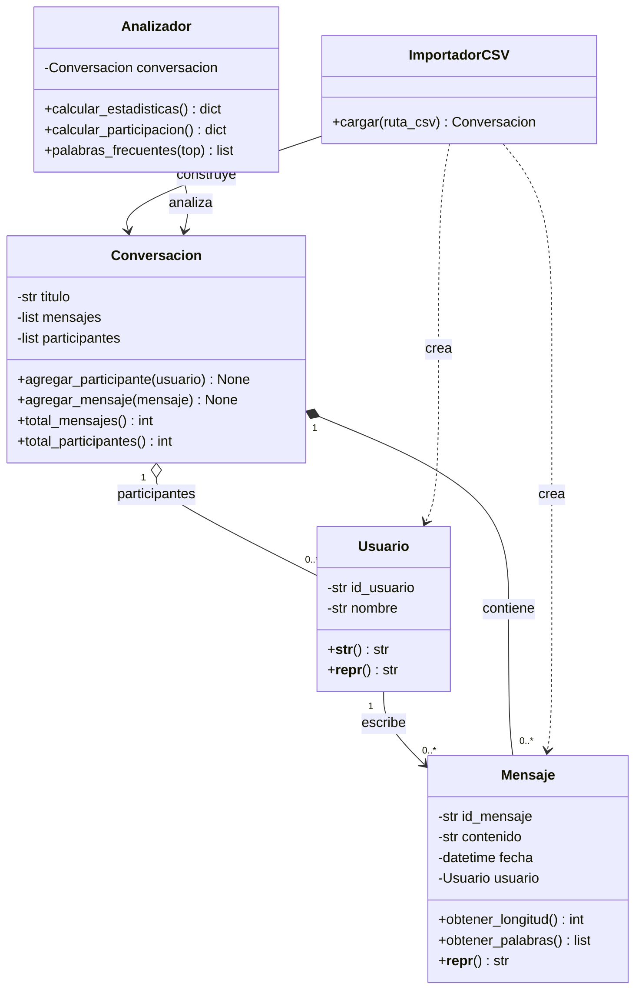

# Analizador de Redes Sociales

Aplicación desarrollada en Python para importar y analizar conversaciones procedentes de redes sociales o plataformas de mensajería.

El proyecto permite representar usuarios, mensajes y conversaciones mediante un modelo orientado a objetos. A partir de una conversación importada desde un archivo CSV, la aplicación calcula estadísticas generales, participación por usuario y frecuencia de palabras.

## Miembros del grupo

- Carlos Anguita Rodríguez
- Javier del Pozo Pérez
- Nicolas Garcia Macias
- Quanan Wei

## Repositorio

El código fuente del proyecto se encuentra disponible en:

[Repositorio de ProyectoRedesSociales](https://github.com/javier-delpozo/ProyectoRedesSociales)

## Objetivo

El objetivo del proyecto es desarrollar una aplicación modular que permita convertir conversaciones exportadas en información comprensible sobre:

- Participación de los usuarios.
- Número de mensajes.
- Palabras más frecuentes.
- Evolución temporal de la actividad.
- Temas tratados en la conversación.
- Informes y representaciones visuales.

El desarrollo se realiza de forma incremental. En PRAC2 se han implementado las primeras funcionalidades del dominio, la importación desde CSV y los análisis básicos.

## Estado actual: PRAC2

En esta iteración se han implementado las siguientes funcionalidades:

- Creación y gestión de usuarios.
- Creación de mensajes asociados a un usuario.
- Gestión de conversaciones.
- Incorporación automática de participantes.
- Importación de conversaciones desde CSV.
- Cálculo del número total de mensajes.
- Cálculo del número total de participantes.
- Cálculo de la participación por usuario.
- Detección básica de palabras frecuentes.
- Pruebas unitarias con pytest.
- Medición de cobertura con pytest-cov.
- Documentación generable con pdoc.

## Estructura del proyecto

```text
social_analyzer/
├── src/
│   ├── __init__.py
│   ├── usuario.py
│   ├── mensaje.py
│   ├── conversacion.py
│   ├── importador.py
│   ├── analizador.py
│   └── main.py
├── tests/
│   ├── datos/
│   │   └── conversacion.csv
│   ├── test_usuario.py
│   ├── test_mensaje.py
│   ├── test_conversacion.py
│   ├── test_importador.py
│   └── test_analizador.py
├── docs/
├── README.md
├── requirements.txt
└── .gitignore
```

## Modelo de dominio

### Usuario

La clase `Usuario` representa a una persona que participa en una conversación.

Sus principales atributos son:

- `id_usuario`: identificador único del participante.
- `nombre`: nombre del participante.

### Mensaje

La clase `Mensaje` representa un mensaje individual de una conversación.

Sus principales atributos son:

- `id_mensaje`: identificador único del mensaje.
- `contenido`: texto del mensaje.
- `fecha`: fecha y hora del mensaje.
- `usuario`: autor del mensaje.

Sus métodos permiten:

- Obtener la longitud del mensaje.
- Obtener las palabras contenidas en el mensaje.

### Conversacion

La clase `Conversacion` agrupa los mensajes y participantes.

Sus responsabilidades son:

- Agregar mensajes.
- Agregar participantes.
- Evitar participantes duplicados.
- Registrar automáticamente al autor de un mensaje.
- Calcular el total de mensajes.
- Calcular el total de participantes.

### ImportadorCSV

La clase `ImportadorCSV` se encarga de leer una conversación desde un archivo CSV y transformarla en objetos del modelo.

El importador:

1. Abre el archivo CSV.
2. Lee sus registros mediante `csv.DictReader`.
3. Identifica a los usuarios.
4. Evita crear varias instancias para un mismo nombre.
5. Convierte las fechas a objetos `datetime`.
6. Construye los mensajes.
7. Incorpora los mensajes a la conversación.
8. Devuelve una instancia de `Conversacion`.

La importación se mantiene separada del modelo y del análisis. Esto permitirá añadir en futuras iteraciones otros importadores para formatos diferentes.

### Analizador

La clase `Analizador` contiene las primeras operaciones de análisis.

Actualmente permite:

- Calcular estadísticas generales.
- Calcular el número de mensajes por usuario.
- Obtener las palabras más frecuentes.

En futuras iteraciones podrá ampliarse o dividirse en analizadores especializados:

- `AnalizadorParticipacion`
- `AnalizadorTemporal`
- `AnalizadorTemas`

## Diagrama UML actualizado



## Flujo actual de la aplicación

```text
Archivo CSV
    |
    v
ImportadorCSV
    |
    v
Conversacion
    |
    +----> Usuario
    |
    +----> Mensaje
    |
    v
Analizador
    |
    +----> Estadísticas generales
    +----> Participación por usuario
    +----> Palabras frecuentes
```

## Formato del archivo CSV

Actualmente, el importador espera un archivo CSV con las siguientes columnas:

```csv
fecha,usuario,mensaje
2026-10-01 10:00,Javier,Hola equipo
2026-10-01 10:05,Carlos,Hola Javier
2026-10-01 10:10,Javier,Vamos con la práctica
```

El formato esperado para la fecha es:

```text
AAAA-MM-DD HH:MM
```

Por ejemplo:

```text
2026-10-01 10:00
```

## Requisitos

- Python 3.
- pytest.
- pytest-cov.
- pdoc.

Las dependencias están recogidas en `requirements.txt`.

## Instalación

Clonar el repositorio:

```bash
git clone https://github.com/javier-delpozo/ProyectoRedesSociales.git
```

Entrar en la carpeta del proyecto:

```bash
cd ProyectoRedesSociales/social_analyzer
```

Crear el entorno virtual:

```bash
python3 -m venv .venv
```

Activarlo en macOS o Linux:

```bash
source .venv/bin/activate
```

Instalar las dependencias:

```bash
pip install -r requirements.txt
```

## Ejecución

Desde la carpeta raíz `social_analyzer`, ejecutar:

```bash
python -m src.main
```

La ejecución actual importa la conversación de ejemplo y muestra un resultado similar a:

```text
=== ANALIZADOR DE REDES SOCIALES ===

{'mensajes': 3, 'participantes': 2}
{'Javier': 2, 'Carlos': 1}
[('hola', 2), ('equipo', 1), ('javier', 1)]
```

## Pruebas unitarias

Las pruebas se encuentran en la carpeta `tests`.

Para ejecutarlas:

```bash
python -m pytest -v
```

En el estado actual del proyecto se ejecutan nueve pruebas unitarias:

- Dos pruebas del analizador.
- Tres pruebas de las conversaciones.
- Dos pruebas del importador CSV.
- Una prueba de los mensajes.
- Una prueba de los usuarios.

Los casos comprobados incluyen:

- Creación de usuarios.
- Longitud de mensajes.
- Creación de una conversación vacía.
- Incorporación de mensajes.
- Control de participantes duplicados.
- Cálculo de estadísticas.
- Cálculo de participación.
- Importación de un archivo CSV.
- Contenido del primer mensaje importado.

## Cobertura

Para ejecutar las pruebas con cobertura:

```bash
python -m pytest --cov=src --cov-report=term-missing
```

La medición permite identificar las líneas del código que todavía no se encuentran cubiertas por las pruebas.

El objetivo orientativo de PRAC2 es alcanzar al menos un 35 % de cobertura. En la revisión realizada antes de incorporar el importador CSV, el proyecto alcanzó un 62 % de cobertura.

La cobertura debe volver a calcularse antes de la entrega para reflejar el código actual.

## Documentación con pdoc

El proyecto utiliza pdoc para generar documentación HTML a partir de los módulos y docstrings.

Para generar la documentación:

```bash
pdoc src -o docs
```

También puede ejecutarse mediante el intérprete activo:

```bash
python -m pdoc src -o docs
```

El resultado se guarda en la carpeta:

```text
docs/
```

Para abrir la documentación en macOS:

```bash
open docs/index.html
```

La documentación debe regenerarse cuando cambien las clases, métodos o docstrings.

## Riesgos y plan de mitigación

### Diferencias entre formatos de entrada

Cada plataforma puede exportar conversaciones con una estructura diferente.

**Mitigación:** mantener la importación separada del dominio y crear clases específicas para cada formato. En futuras iteraciones podrán incorporarse importadores como `ImportadorWhatsApp` o `ImportadorTelegram`.

### Filas incompletas o incorrectas

Un archivo CSV puede contener fechas inválidas, usuarios vacíos o mensajes incompletos.

**Mitigación:** incorporar validaciones explícitas y mensajes de error comprensibles en la siguiente iteración.

### Detección de temas demasiado básica

La frecuencia de palabras puede incluir artículos, preposiciones y palabras poco representativas.

**Mitigación:** añadir normalización básica, limpieza de signos y eliminación de palabras vacías. No se plantea utilizar procesamiento lingüístico avanzado mientras no sea necesario.

### Crecimiento de la clase Analizador

La incorporación de nuevos análisis podría hacer que `Analizador` acumule demasiadas responsabilidades.

**Mitigación:** estudiar su división en analizadores especializados, como `AnalizadorParticipacion`, `AnalizadorTemporal` y `AnalizadorTemas`.

### Volumen de mensajes

Las conversaciones muy grandes podrían requerir más memoria y aumentar el tiempo de procesamiento.

**Mitigación:** evaluar el procesamiento progresivo de registros y evitar duplicar datos innecesariamente.

### Persistencia

Actualmente, las conversaciones importadas y los resultados solo existen durante la ejecución.

**Mitigación:** estudiar en PRAC3 mecanismos para guardar conversaciones, resultados o informes generados.

### Integración del trabajo del equipo

Los cambios simultáneos pueden provocar conflictos o inconsistencias.

**Mitigación:** utilizar ramas por funcionalidad, realizar commits pequeños y revisar los cambios antes de integrarlos en `main`.

## Decisiones de diseño

### Separación de responsabilidades

El proyecto diferencia cuatro áreas:

```text
Dominio
    Usuario, Mensaje y Conversacion

Importación
    ImportadorCSV

Análisis
    Analizador

Presentación
    main.py y futuros informes
```

Esta separación evita que la lectura de archivos quede mezclada con las reglas del dominio o con los cálculos estadísticos.

### Uso de CSV como primer formato

CSV se utiliza como primer formato porque permite probar el flujo completo de importación sin depender de una plataforma concreta.

La arquitectura está preparada para incorporar formatos adicionales mediante nuevas clases de importación.

### Análisis de texto básico

La detección de palabras frecuentes utiliza operaciones sencillas de normalización y recuento.

En esta fase se prioriza la arquitectura, la programación orientada a objetos y la calidad del código frente al uso de técnicas avanzadas de procesamiento del lenguaje natural.

## Limitaciones actuales

- Solo se admite un formato CSV concreto.
- No se validan todavía todas las entradas incorrectas.
- Las palabras frecuentes incluyen palabras vacías.
- No existe todavía análisis temporal.
- No se generan gráficos.
- No existe persistencia.
- No se genera todavía un informe final.

## Roadmap

### PRAC2

- Modelo de dominio funcional.
- Importación desde CSV.
- Estadísticas generales.
- Participación por usuario.
- Frecuencia básica de palabras.
- Pruebas unitarias.
- Cobertura de código.
- Documentación generable con pdoc.
- UML actualizado.

### PRAC3

- Validación de archivos de entrada.
- Normalización del texto.
- Eliminación de palabras vacías.
- Análisis temporal.
- Persistencia de conversaciones o resultados.
- Importadores adicionales si resultan necesarios.
- Ampliación de pruebas.

### PRAC4

- Informes visuales.
- Gráficos de participación y actividad.
- Integración completa.
- Mejora de la cobertura.
- Documentación final.
- Preparación de la demostración.
- Etiquetado de la versión final.
