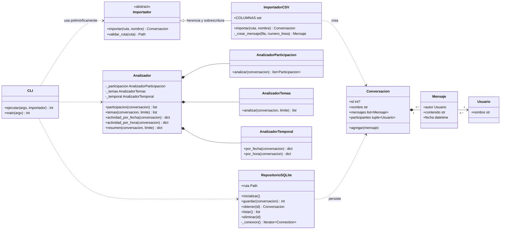

# Analizador de Redes Sociales · v1.0.0

Aplicación Python para importar conversaciones CSV, normalizarlas, guardarlas en SQLite y generar métricas de participación, temas frecuentes y actividad temporal.

## Entrega final PRAC4

La versión 1.0.0 cierra el alcance con:

- arquitectura por capas y dominio independiente de la infraestructura;
- importador abstracto y una implementación CSV sustituible;
- persistencia SQLite transaccional con cierre garantizado de conexiones;
- análisis por componentes especializados y fachada pública estable;
- salidas JSON/CSV y un informe visual HTML autocontenido;
- logging y errores controlados;
- suite automatizada con una prueba de integración extremo a extremo y umbral mínimo de cobertura del **70 %**;
- CI en Windows, macOS y Linux;
- documentación API generable, guía de uso, demo reproducible y materiales de exposición.

El feedback de PRAC3 recomendó consolidar la calidad y preservar la simplicidad antes que añadir funcionalidades sin una necesidad clara. La entrega final sigue esa recomendación: endurece pruebas, documentación, reproducibilidad y compatibilidad multiplataforma sin sobreingeniería.

# UML de la versión 1.0.0

El diagrama refleja la arquitectura implementada en `src/analizador_redes`. Las relaciones de composición muestran que la fachada `Analizador` coordina servicios especializados, pero no implementa sus algoritmos.



## Decisiones representadas

- **Abstracción:** `Importador` define el contrato común y no puede instanciarse.
- **Herencia y sobrescritura:** `ImportadorCSV` hereda de `Importador` e implementa `importar`.
- **Polimorfismo:** `cli.ejecutar` recibe opcionalmente cualquier `Importador`; la implementación CSV es solo el valor por defecto.
- **Responsabilidad única:** los algoritmos de participación, temas y tiempo viven en analizadores separados.
- **Compatibilidad:** `Analizador` sigue ofreciendo los métodos públicos de PRAC2 y actúa únicamente como fachada de composición.
- **Gestión de recursos:** `RepositorioSQLite._conexion` delimita transacción y cierre con un gestor de contexto.

## Inicio rápido

Requiere Python 3.10 o posterior.

### Windows PowerShell

```powershell
git clone https://github.com/javier-delpozo/ProyectoRedesSociales.git
cd ProyectoRedesSociales\social_analyzer   # si el repositorio mantiene esta subcarpeta
# o: cd ProyectoRedesSociales               # si pyproject.toml está en la raíz

py -3 -m venv .venv
Set-ExecutionPolicy -Scope Process -ExecutionPolicy Bypass
.\.venv\Scripts\Activate.ps1
python -m pip install --upgrade pip
python -m pip install -e ".[dev]"
pytest
```

También puede ejecutarse todo el preparado local con:

```powershell
powershell -ExecutionPolicy Bypass -File scripts\preparar_windows.ps1
```

### macOS/Linux

```bash
git clone https://github.com/javier-delpozo/ProyectoRedesSociales.git
cd ProyectoRedesSociales/social_analyzer  # si existe la subcarpeta
python3 -m venv .venv
source .venv/bin/activate
python -m pip install --upgrade pip
python -m pip install -e ".[dev]"
pytest
```

O bien:

```bash
sh scripts/preparar_unix.sh
```

## Demo reproducible

Con el entorno activado:

```powershell
python scripts/demo.py
```

El script usa rutas `pathlib` y funciona igual en Windows, macOS y Linux. Crea una base y salidas temporales dentro de `build/demo`, sin tocar datos del usuario.

Flujo manual equivalente:

```powershell
python -m analizador_redes --version
python -m analizador_redes validar ejemplos/conversacion.csv
python -m analizador_redes --db build/demo.sqlite3 importar ejemplos/conversacion.csv --nombre Demo
python -m analizador_redes --db build/demo.sqlite3 listar
python -m analizador_redes --db build/demo.sqlite3 analizar 1 --top 5 -o build/resumen.json --html build/informe.html
python -m analizador_redes --db build/demo.sqlite3 exportar 1 build/mensajes.csv
```

La instalación añade el comando equivalente `analizador-redes`.

## Informe visual

La opción `--html` genera un informe visual estático con:

- número total de mensajes;
- número de participantes;
- distribución de participación;
- temas frecuentes;
- actividad temporal.

Por ejemplo:

```powershell
python -m analizador_redes --db build/demo/demo.sqlite3 analizar 1 `
    --top 5 `
    -o build/demo/resumen.json `
    --html build/demo/informe.html
```

Después puede abrirse directamente en Windows:

```powershell
Start-Process ".\build\demo\informe.html"
```

En macOS:

```bash
open build/demo/informe.html
```

En Linux:

```bash
xdg-open build/demo/informe.html
```

El HTML es un **artefacto generado por la aplicación Python**, no una aplicación web independiente. Es autocontenido, funciona sin servidor y no necesita recursos externos.


## Formato de entrada

El CSV debe usar UTF-8 y contener `autor`, `contenido` y `fecha` en ISO 8601:

```csv
autor,contenido,fecha
Ana,Revisamos el lanzamiento,2026-10-30T09:00:00+01:00
Luis,El informe está listo,2026-10-30T10:15:00+01:00
```

Se permiten columnas adicionales. Una fila inválida detiene la importación y el error identifica la fila.

### Dataset de demostración

El repositorio incluye un conjunto de datos completamente sintético para la demostración, formado por 300 mensajes de 6 participantes distribuidos a lo largo de 14 días.

Los datos no proceden de conversaciones reales y no contienen información personal.

## Arquitectura

```text
CSV -> Importador (ABC) -> Conversacion -> Analizador (fachada)
                                             |-- AnalizadorParticipacion
                                             |-- AnalizadorTemas
                                             `-- AnalizadorTemporal
                   |-> RepositorioSQLite
                   `-> reporting JSON/CSV/HTML
```

`Analizador` conserva una API sencilla y delega los cálculos. `ImportadorCSV` implementa el contrato `Importador`, de forma que otro formato podría añadirse sin acoplar el dominio ni la persistencia. Consulta el [UML completo](docs/uml.md).

## Pruebas y calidad

```powershell
pytest
pytest -m integration
ruff check .
python -W error::ResourceWarning -m pytest
```

`pyproject.toml` mide líneas y ramas y falla por debajo del 70 %. La prueba marcada como `integration` recorre validación, importación, SQLite, análisis, exportación y eliminación. La CI repite las comprobaciones en Python 3.10 y 3.12 sobre Windows, macOS y Linux.

## Documentación publicable

- [Guía de usuario](docs/guia_usuario.md)
- [Guía de desarrollo](docs/guia_desarrollo.md)
- [UML](docs/uml.md)
- [Evidencias de PRAC4](docs/prac4.md)
- [Auditoría final y matriz de cumplimiento](docs/auditoria_prac4.md)
- [Guion de exposición](docs/guion_presentacion.md)
- [Coevaluación](docs/coevaluacion.md)
- [Checklist de entrega](docs/checklist_entrega.md)
- [Integración en Windows](docs/instrucciones_windows.md)
- [Changelog](CHANGELOG.md)

Generar documentación API HTML:

```powershell
python scripts/generar_documentacion.py
```

La salida se crea en `build/docs/api`. La CI publica esa carpeta como artefacto.

## Registro de contribuciones

El historial Git es la fuente objetiva para el recuento de commits:

```powershell
python scripts/generar_contribuciones.py
```

El comando genera `docs/contribuciones_generadas.md`. La tabla cualitativa debe revisarse en grupo:
el número de commits no determina por sí solo esfuerzo ni calidad y no se atribuyen tareas sin evidencia.

## Publicación de v1.0.0

Después de fusionar los cambios, completar contribuciones/coevaluación y comprobar la CI:

```powershell
git tag -a v1.0.0 -m "Entrega final PRAC4"
git push origin v1.0.0
```

No se incluye una etiqueta dentro del ZIP porque las etiquetas pertenecen al historial Git del repositorio.

## Limitaciones explícitas

- El formato de entrada implementado es CSV; otros importadores son una extensión futura.
- El análisis de temas usa frecuencias normalizadas, no NLP semántico.
- SQLite está orientado a uso local y volúmenes pequeños o medianos.
- Las conversaciones reales pueden contener datos personales; deben anonimizarse antes de compartirlas.

## Atribuciones

Durante la preparación se utilizaron asistentes de IA para revisar documentación, proponer casos de
prueba, depurar compatibilidad multiplataforma y mejorar el informe y la presentación. El equipo revisó
el código resultante y conserva la responsabilidad completa sobre su funcionamiento, estructura,
seguridad y posibles errores, conforme a la política de la asignatura.
