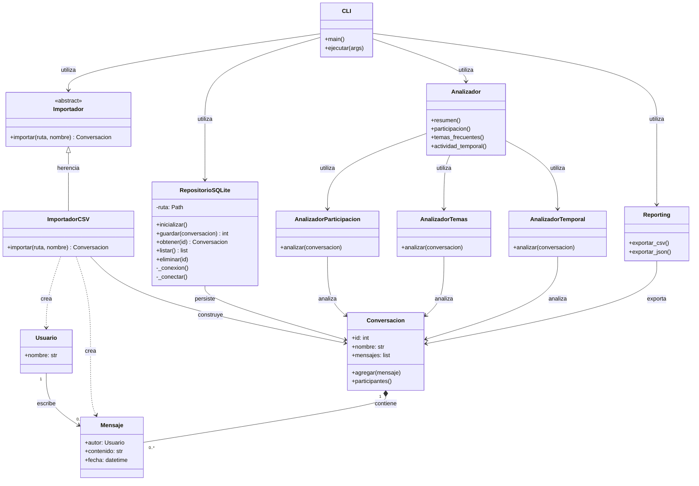

# Analizador de Redes Sociales

Aplicación Python para importar conversaciones exportadas, normalizarlas y obtener métricas de participación, temas frecuentes y actividad temporal.

## Diagrama UML

El siguiente diagrama representa la arquitectura actual del Analizador de Redes Sociales. 
El diseño separa el dominio, la importación de datos, el análisis, la persistencia y la interfaz de línea de comandos.



### Decisiones de diseño

La arquitectura se ha dividido en varias responsabilidades:

- **Dominio:** `Usuario`, `Mensaje` y `Conversacion` representan las entidades principales.
- **Importación:** `Importador` define una abstracción común y `ImportadorCSV` implementa la importación desde CSV.
- **Análisis:** las responsabilidades se dividen entre `AnalizadorParticipacion`, `AnalizadorTemas` y `AnalizadorTemporal`.
- **Persistencia:** `RepositorioSQLite` permite almacenar y recuperar conversaciones mediante SQLite.
- **Presentación:** la CLI coordina las operaciones disponibles para el usuario.
- **Salida:** el módulo de reporting permite exportar los resultados.

La relación entre `Importador` e `ImportadorCSV` permite aplicar herencia, abstracción, sobrescritura y polimorfismo. De esta forma pueden incorporarse otros importadores en el futuro sin modificar el modelo de dominio.

La separación de los distintos tipos de análisis evita concentrar todas las responsabilidades en una única clase y facilita la ampliación del proyecto.


## Estado de PRAC3

La entrega incorpora:

- importación de CSV UTF-8 con validación y errores contextualizados por fila;
- abstracción `Importador` e implementación `ImportadorCSV`, con herencia, sobrescritura y sustitución polimórfica;
- analizadores especializados de participación, temas y actividad temporal, compuestos por una fachada compatible `Analizador`;
- persistencia transaccional en SQLite, con cierre garantizado de todas las conexiones;
- consulta, eliminación y exportación de conversaciones;
- logging por consola y, opcionalmente, a fichero rotatorio;
- paquete instalable y ejecución con `python -m analizador_redes` o `analizador-redes`;
- pruebas con cobertura de líneas y ramas y umbral mínimo automatizado del 55 %;
- documentación de usuario, desarrollo, evidencias de PRAC3 y UML actualizado.

## Inicio rápido

Requiere Python 3.10 o posterior.

```bash
python -m venv .venv
# Linux/macOS
source .venv/bin/activate
# Windows PowerShell: .venv\Scripts\Activate.ps1
python -m pip install -e ".[dev]"

python -m analizador_redes validar ejemplos/conversacion.csv
python -m analizador_redes --db datos/demo.sqlite3 importar ejemplos/conversacion.csv --nombre Demo
python -m analizador_redes --db datos/demo.sqlite3 listar
python -m analizador_redes --db datos/demo.sqlite3 analizar 1 -o informes/resumen.json
```

La instalación añade el comando equivalente `analizador-redes`:

```bash
analizador-redes --db datos/demo.sqlite3 analizar 1 --top 10
```

## Formato de entrada

El CSV debe usar UTF-8 y contener las columnas `autor`, `contenido` y `fecha`. La fecha acepta ISO 8601.

```csv
autor,contenido,fecha
Ana,Revisamos el lanzamiento,2026-10-30T09:00:00+01:00
Luis,El informe está listo,2026-10-30T10:15:00+01:00
```

## Arquitectura

La solución mantiene las fronteras entre dominio, entrada, análisis, persistencia, salida y CLI:

```text
CSV -> Importador (ABC) -> Conversacion -> Analizador (fachada)
                                            |-- AnalizadorParticipacion
                                            |-- AnalizadorTemas
                                            `-- AnalizadorTemporal
                  |-> RepositorioSQLite
                  `-> reporting JSON/CSV
```

`Analizador` conserva la API de PRAC2, pero ya no concentra los algoritmos: delega cada cálculo a un componente especializado e inyectable. `ImportadorCSV` implementa el contrato abstracto `Importador`, por lo que la CLI puede trabajar con futuras implementaciones sin cambiar su flujo.

Consulta el [diagrama UML completo](docs/uml.md).

## Documentación

- [Guía de usuario](docs/guia_usuario.md)
- [Guía de desarrollo](docs/guia_desarrollo.md)
- [UML](docs/uml.md)
- [Evidencias y criterios de aceptación de PRAC3](docs/prac3.md)

## Calidad

```bash
pytest
ruff check .
```

Para convertir cualquier conexión SQLite no cerrada en un fallo durante la comprobación:

```bash
python -W error::ResourceWarning -m pytest
```

`pytest` calcula cobertura de ramas y falla si la cobertura total es inferior al 55 %.

## Estructura

```text
src/analizador_redes/  paquete de aplicación
tests/                 pruebas unitarias, de adaptadores y de integración CLI
docs/                  guías, UML y evidencias
ejemplos/               datos de ejemplo
```

## Limitaciones actuales

- El importador incluido en esta iteración es CSV; el contrato abstracto permite añadir otros formatos.
- El análisis de temas se basa en frecuencias normalizadas, no en NLP semántico.
- SQLite está orientado a uso local y a volúmenes pequeños o medianos.
