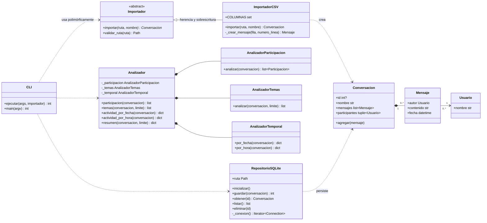

# UML de PRAC3

El diagrama refleja la arquitectura implementada en `src/analizador_redes`. Las relaciones de composición muestran que la fachada `Analizador` coordina servicios especializados, pero no implementa sus algoritmos.

## Decisiones representadas

- **Abstracción:** `Importador` define el contrato común y no puede instanciarse.
- **Herencia y sobrescritura:** `ImportadorCSV` hereda de `Importador` e implementa `importar`.
- **Polimorfismo:** `cli.ejecutar` recibe opcionalmente cualquier `Importador`; la implementación CSV es solo el valor por defecto.
- **Responsabilidad única:** los algoritmos de participación, temas y tiempo viven en analizadores separados.
- **Compatibilidad:** `Analizador` sigue ofreciendo los métodos públicos de PRAC2 y actúa únicamente como fachada de composición.
- **Gestión de recursos:** `RepositorioSQLite._conexion` delimita transacción y cierre con un gestor de contexto.
